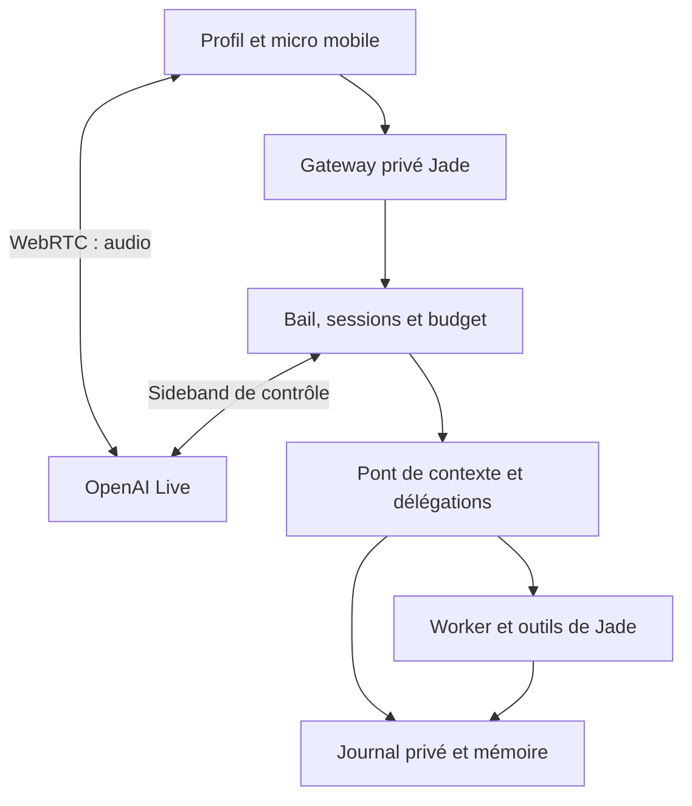

# Live mobile — architecture raccordée le 26 novembre 2026

**Branche : `develop`.** Le propriétaire autorise l’intégration le 26/11 pour effectuer la recette mobile. Le lot provient de `feat/live-mobile-20261126`, commit `90ec0c7`, descendant de develop `6dc8d1b`. Le code est intégré ; les observations OpenAI/Redmi restent à réaliser.

[Cadrage initial](../backlog/PLAN-LIVE-MOBILE.md) · [REC-044 à REC-050](../backlog/02-RECETTE.md) · [Passation et preuves](../operations/handoffs/2026-11-26-chatgpt-live-mobile-implementation.md).

## Responsabilités et transport

`live_runtime.create_mobile_live` assemble les composants dans `main.py` lorsque le gateway mobile est lancé. Le constructeur n'ouvre pas de microphone et ne crée pas de session fournisseur. Au démarrage, le registre peut retrouver des identifiants payants non finalisés : leur réconciliation tente une fermeture, jamais une reprise de conversation.

| Composant | Responsabilité |
| --- | --- |
| `live_config.py`, `live_voice.py` | Configuration distincte du TTS classique, bornes, voix explicite et préflight sans réseau |
| `live_provider.py` | Création HTTP WebRTC, identifiant fournisseur, sideband et commandes autorisées ; erreurs sans corps privé |
| `live_sessions.py` | Préférence propriétaire, bail exclusif, génération fournisseur, admission, watchdog indépendant et clôture |
| `live_budget.py` | Réservations atomiques SQLite, usage cumulatif, estimations et rapprochement |
| `mobile_live.py`, `mobile_gateway.py` | Routes mêmes origine/identité/Bearer, contrôle WebSocket et limites de taille |
| `live_bridge.py` | Persona, contexte, segments, journal, actions idempotentes, mémoire et délégations |
| `live-client.js`, `live-audio-worklet.js` | Permission, VAD locale, tampon, WebRTC, lecture, supervision réciproque et nettoyage |
| `app.js` | Profil, micro commun, chat, documents et commandes de l'avatar existant |

Le modèle est `gpt-live-1.1`. L'adaptateur utilise `httpx2`, déjà dépendance de l'OpenAI SDK épinglé `3.42.1`, et `websockets`. Le SDK inspecté ne déclare pas encore tous les champs de veille et d'usage employés ; le transport JSON conserve les champs officiels sans modifier la version du SDK. Les créations n'ont aucun retry automatique.

## Trois états indépendants

1. **Préférence** `classic/live` persistée avec révision monotone. ON seul ne capture rien. OFF depuis un autre client révoque le propriétaire actif ; un ancien ON ne rétablit pas un choix plus récent.
2. **Bail local** exclusif, acquis avant `getUserMedia`, états `armed/draining/closed`. Il reste sous contrôle même pendant la permission Android ou une veille sans fournisseur.
3. **Session fournisseur** liée au bail, au fil et à une génération. `opening`, `active`, `standby`, `closing`, `closed`, `opening_unknown` et `close_unconfirmed` décrivent ce qui est réellement connu. L'identifiant fournisseur reste sur le serveur ; la PWA manipule un handle applicatif.

La fermeture idle ne libère pas le bail armé : une nouvelle parole ouvre une nouvelle génération. OFF, texte, nouveau fil, changement de modèle, son coupé, arrière-plan, perte réseau/authentification ou arrêt serveur révoquent le bail et la génération avant les attentes réseau. Le retour au premier plan, du réseau ou du son ne réarme rien.

Un mute après entrée utilisateur peut laisser finir la réponse demandée pendant **15 s au maximum**, sans prolongation par un heartbeat ou un second mute. Si aucune entrée n'a été envoyée, l'arrêt est direct. La fermeture des pistes et de la lecture locale reste distincte de la confirmation fournisseur.

## Audio et arrêt

Le Worklet maintient un pré-roll de **500 ms**, une confirmation VAD de **60 ms** et un tampon total de **8 s**, pré-roll compris. La première parole est conservée pendant la négociation, puis réinjectée par `MediaStreamAudioDestinationNode` dans la piste WebRTC. Le rattrapage retire uniquement des plages classées silencieuses par la VAD ; il préserve les échantillons classés vocaux et le tampon initial protégé. L'absence de perte phonétique reste à valider sur Redmi. Un dépassement impose un nouvel essai explicite.

La permission n'est demandée qu'après admission et contrôle connecté. Le heartbeat toutes les **2 s**, avec séquence et acquittement, expire après **5 s**. La permission en attente autorise `capture=closed` sans être confondue avec un arrêt. La PWA coupe le média si le serveur ne répond plus, même si WebRTC continue de fonctionner.

Le fournisseur reçoit `wake_policy.type=speech`, `idle_timeout_s=8`, `store=false`, délégation `client` et `allowed_client_events=[]`. Les premiers échantillons ne dépendent pas de `session.resumed`. Aucun `session.start`, `response.create`, `response.cancel` ou PCM sideband n'est inventé. Le backend attend `session.started`, ou un événement prouvant que la session a déjà démarré, avant les commandes ordinaires.

La fermeture envoie `session.close` avec récepteur installé. Seul `session.closed` confirme le terminal. La borne nominale de **5 s** inclut attachement et envoi ; un transport lent à nettoyer n'empêche pas de signaler l'incertitude. Le close reste autorisé après retrait de flag/budget et en cas d'erreur de stockage. Une création HTTP tardive est fermée dès que son identifiant devient connu. Une création sans identifiant ou un terminal manquant conserve sa réservation et bloque une nouvelle session ; fermer le socket ne suffit pas.

Les valeurs sont des garde-fous applicatifs, pas une garantie d'arrêt instantané de facturation en cas de panne simultanée du serveur et du fournisseur. La recette réelle doit mesurer le résidu et les délais.

## Jade, outils, histoire et mémoire

Le dialogue oral simple est natif Live. Les délégations utilisent `Runtime.submit_operation`, le même worker et le même `TurnArbiter` que le classique. Aucune session Live ne monopolise ce worker pendant toute sa durée. Cette évolution ne promet donc plus une sérialité absolue de toutes les paroles entre canaux ; les opérations métier communes restent arbitrées.

Le pont prépare la persona existante et le contexte du même fil `mobile/Goldaj`. Il reconstruit les demandes à partir des segments et de l'offset de délégation, attend brièvement un fragment manquant et demande une précision si nécessaire. La délégation ne lance pas un second STT/TTS et ne passe pas par `on_reply`, évitant une deuxième sortie publique ou privée.

Les segments conservent leurs IDs, intervalles, corrections et états de diffusion. Un transcript n'est jamais une preuve d'audition. Le journal et les écritures L1 respectent l'identité et le consentement : une suppression/changement de profil pendant la session ne réattribue pas ses contenus. L'historique classique est invalidé/actualisé sous verrou et révision communs après persistance Live.

Les outils mémoire, web, fichiers et rappels conservent leurs contrôles et leur politique : lecture/divulgation globale L1/L2/L3 avec provenance, demande explicite L2 réservée à Goldaj, Core choisies par Jade. Les actions sont suivies `started/committed/unknown` avec empreinte métier. Après une interruption entre effet et acquittement, aucune répétition automatique d'un effet incertain n'est faite.

La clôture ne lance pas de nouvelle curation facturée : elle termine la persistance locale et garde les candidats dans le journal. Leur traitement borné est proposé à la prochaine session active, avec sa propre admission budgétaire et les filtres du `MemoryService` existant. Il reste différé, sans accusé SQLite imposé à la parole. Le journal Live est une base séparée, à rétention de 7 jours ; aucune migration destructive de la mémoire principale n'est introduite.

## Coûts et mesures

Le budget Live est **distinct du futur seuil global Discord en EUR**. Ses plafonds quotidiens et mensuels sont en USD et utilisent les frontières civiles Europe/Paris. Zéro interdit les nouvelles sessions. Une réservation voix couvre conservativement durée maximale, ouverture et clôture, avec prise en compte des 15 s initiales sans addition en double.

L'usage fournisseur est cumulatif : `12 → 15 → 15` reste 15 s. Les composantes actif/standby sont prises en compte lorsqu'elles sont présentes ; le manque est estimé au tarif actif. Une estimation temporelle ne s'ajoute pas au compteur fournisseur. Les consommations confirmées remplacent les estimations et libèrent seulement le solde justifié ; les réservations non soldées traversent les changements de période.

Chaque délégation, y compris la curation, réserve le montant configuré avant travail. **Le coût backend reste une estimation de l'opération complète**, distincte de la voix : le nombre de tokens ne décrit pas tous les frais d'outils. Un résultat terminé conserve la totalité du montant initial admis comme consommation estimée ; une annulation/issue inconnue conserve la réservation. Le rapprochement facture peut ensuite corriger l'estimation. Ce montant doit être calibré sur les modèles et les outils autorisés ; il ne constitue pas un relevé exhaustif des API de Jade ni une garantie absolue de plafond fournisseur.

`TurnMetrics` et les événements techniques enregistrent ouverture, SDP prêt, actif/standby, délégations, lecture signalée, demande de fermeture et terminal, sans audio, SDP ou texte privé. `/api/metrics` conserve ses métriques classiques et ajoute `live_budget`. La lecture signalée par le client est un point d'observation logiciel, jamais le premier son utile réellement entendu. Le benchmark A/B et ses p50/p95 physiques restent à mesurer selon REC-046 ; aucun gain chiffré n'est annoncé.

## Voix et suite Discord

**Aube** reste la préférence du propriétaire pour le prototype. Sa présence dans ChatGPT ne prouve pas un ID d'API utilisable ; aucune équivalence avec **Brise** n'est affirmée. La configuration initiale explicite `brise`, affiche cette limite dans Profil et accepte un ID de voix personnalisée. `scripts/live_voice_preview.py` prépare le prompt original et sept cas français sans créer de voix ni payer une préécoute. Création, écoute et choix sont encore DEV-041.

`JADE_DISCORD_LIVE_ENABLED=0` reste réservé. L'activer sans adaptateur produit un diagnostic, sans remplacer la chaîne Discord classique. **DEV-052** est une étape future : toutes API confondues, Live Discord sous 50 EUR/mois, ou 40 EUR si couverture/fréquence insuffisante, puis bascule vers le classique. Les préférences, sessions et budgets propres du mobile ne sont pas pilotés par cette règle. La consommation du mobile contribue seulement au total utilisé pour la décision Discord.

## Contrats officiels vérifiés pour l'implémentation

- [Connexion Live WebRTC](https://developers.openai.com/api/docs/guides/voice-webrtc)
- [Contrôle serveur et sideband](https://developers.openai.com/api/docs/guides/voice-server-controls)
- [Conversations, veille et usage](https://developers.openai.com/api/docs/guides/live-conversations)
- [Délégations Live](https://developers.openai.com/api/docs/guides/live-delegation)
- [GPT-Live-1.1](https://developers.openai.com/api/docs/models/gpt-live-1.1)
- [Voix personnalisées](https://developers.openai.com/api/docs/guides/custom-voices)
