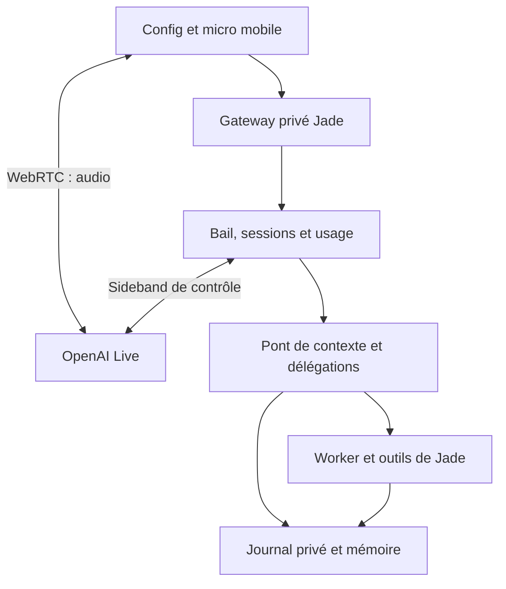

# Live mobile — architecture raccordée le 26 novembre 2026

**Branche : `develop`.** Le propriétaire autorise l’intégration le 26/11 pour effectuer la recette mobile. Le lot provient de `feat/live-mobile-20261126`, commit `90ec0c7`, descendant de develop `6dc8d1b`. Le code est intégré ; les observations OpenAI/Redmi restent à réaliser.

[Cadrage initial](../backlog/PLAN-LIVE-MOBILE.md) · [REC-044 à REC-050](../backlog/02-RECETTE.md) · [Passation et preuves](../operations/handoffs/2026-11-26-chatgpt-live-mobile-implementation.md).

## Responsabilités et transport

`live_runtime.create_mobile_live` assemble les composants dans `main.py` lorsque le gateway mobile est lancé. Le constructeur n'ouvre pas de microphone et ne crée pas de session fournisseur. Au démarrage, le registre peut retrouver des identifiants payants non finalisés : leur réconciliation tente une fermeture, jamais une reprise de conversation.

| Composant | Responsabilité |
| --- | --- |
| `live_config.py`, `live_voice.py` | Configuration distincte du TTS classique, bornes, voix explicite et préflight sans réseau |
| `live_provider.py` | Création HTTP WebRTC, identifiant fournisseur, sideband et commandes autorisées ; erreurs sans corps privé |
| `live_sessions.py` | Préférence propriétaire, bail exclusif, génération fournisseur, admission, watchdog indépendant et clôture |
| `live_usage.py` | Usage cumulatif SQLite et estimations passives, sans plafond ni admission financière |
| `mobile_live.py`, `mobile_gateway.py` | Routes mêmes origine/identité/Bearer, contrôle WebSocket et limites de taille |
| `live_bridge.py` | Persona, contexte, segments, journal, actions idempotentes, mémoire et délégations |
| `live-client.js`, `live-audio-worklet.js` | Permission, VAD locale, tampon, WebRTC, lecture, supervision réciproque et nettoyage |
| `app.js` | Choix Live/classique dans Config, commande de capture sur la scène, indicateurs visuels, chat, documents et commandes de l’avatar |

Le modèle est `gpt-live-1.1`. L'adaptateur utilise `httpx2`, déjà dépendance de l'OpenAI SDK épinglé `3.42.1`, et `websockets`. Le SDK inspecté ne déclare pas encore tous les champs de veille et d'usage employés ; le transport JSON conserve les champs officiels sans modifier la version du SDK. Les créations n'ont aucun retry automatique.

## Trois états indépendants

1. **Préférence** `classic/live` persistée avec révision monotone ; défaut `live`, choix `classic` explicite conservé. ON seul ne capture rien. OFF depuis un autre client révoque le propriétaire actif ; un ancien ON ne rétablit pas un choix plus récent.
2. **Bail local** exclusif, acquis avant `getUserMedia`, états `armed/draining/closed`. Il reste sous contrôle même pendant la permission Android ou une veille sans fournisseur.
3. **Session fournisseur** liée au bail, au fil et à une génération. `opening`, `active`, `standby`, `closing`, `closed`, `opening_unknown` et `close_unconfirmed` décrivent ce qui est réellement connu. `retired_unconfirmed` indique qu’une génération locale a été retirée sur demande de reprise et que sa facturation finale reste inconnue. L’identifiant fournisseur reste sur le serveur. La PWA manipule un identifiant applicatif.

La fermeture idle ne libère pas le bail armé : une nouvelle parole ouvre une nouvelle génération. OFF, texte, nouveau fil, changement de modèle, son coupé, arrière-plan, perte réseau/authentification ou arrêt serveur révoquent le bail et la génération avant les attentes réseau. Le retour au premier plan, du réseau ou du son ne réarme rien.

Un mute après entrée utilisateur peut laisser finir la réponse demandée pendant **15 s au maximum**, sans prolongation par un heartbeat ou un second mute. Si aucune entrée n'a été envoyée, l'arrêt est direct. La fermeture des pistes et de la lecture locale reste distincte de la confirmation fournisseur.

## Audio et arrêt

Le navigateur raccorde la piste distante WebRTC à un lecteur audio. Un analyseur observe cette piste pour la bouche et la motion de parole. Si le navigateur refuse la lecture du lecteur, la sortie Web Audio déjà déverrouillée prend le relais et le lecteur reste muet. La fermeture ou le remplacement de la piste détache le lecteur et remet l’avatar au repos.

Le Worklet maintient un pré-roll de **500 ms**, une confirmation VAD de **60 ms** et un tampon total de **8 s**, pré-roll compris. La première parole est conservée pendant la négociation, puis réinjectée par `MediaStreamAudioDestinationNode` dans la piste WebRTC. Le rattrapage retire uniquement des plages classées silencieuses par la VAD ; il préserve les échantillons classés vocaux et le tampon initial protégé. L'absence de perte phonétique reste à valider sur Redmi. Un dépassement impose un nouvel essai explicite.

La permission n'est demandée qu'après admission et contrôle connecté. Le heartbeat toutes les **2 s**, avec séquence et acquittement, expire après **5 s**. La permission en attente autorise `capture=closed` sans être confondue avec un arrêt. La PWA coupe le média si le serveur ne répond plus, même si WebRTC continue de fonctionner.

Le fournisseur reçoit `wake_policy.type=speech`, `idle_timeout_s=8`, `store=false`, délégation `client` et `allowed_client_events=[]`. Les premiers échantillons ne dépendent pas de `session.resumed`. Aucun `session.start`, `response.create`, `response.cancel` ou PCM sideband n'est inventé. Le backend attend `session.started`, ou un événement prouvant que la session a déjà démarré, avant les commandes ordinaires. Les quatre événements serveur autorisés sont transmis comme objets `{"type": "session.started"}` (puis `session.resumed`, `session.paused`, `session.closed`), conformément au schéma `ServerEventSelector` ; une liste de chaînes est refusée avant réseau. Le test du corps HTTP est validé par le schéma officiel du SDK épinglé.

La fermeture envoie `session.close` avec le récepteur installé. Seul `session.closed` confirme la finalisation fournisseur. La borne nominale de **5 s** inclut attachement et envoi. Une création HTTP tardive est fermée dès que son identifiant devient connu. Tant qu’une fermeture est en cours ou que la création reste ambiguë sans identifiant, la capture attend. Si une génération connue est déjà arrêtée localement et que la tentative bornée se termine sans terminal, **Réessayer** peut retirer cette génération du parcours actif. Le registre et le relevé d’usage conservent l’incertitude. Un nouveau geste sur le micro est nécessaire avant toute ouverture. [Récupération après perte de connexion GPT-Live](https://developers.openai.com/api/docs/guides/live-conversations#recover-from-a-failed-connection)

Les valeurs sont des garde-fous applicatifs, pas une garantie d'arrêt instantané de facturation en cas de panne simultanée du serveur et du fournisseur. La recette réelle doit mesurer le résidu et les délais.

## Jade, outils, histoire et mémoire

Le dialogue oral simple est natif Live. Les délégations utilisent `Runtime.submit_operation`, le même worker et le même `TurnArbiter` que le classique. Aucune session Live ne monopolise ce worker pendant toute sa durée. Cette évolution ne promet donc plus une sérialité absolue de toutes les paroles entre canaux ; les opérations métier communes restent arbitrées.

Le pont prépare la persona existante et le contexte du même fil `mobile/Goldaj`. Il reconstruit les demandes à partir des segments et de l'offset de délégation, attend brièvement un fragment manquant et demande une précision si nécessaire. La délégation ne lance pas un second STT/TTS et ne passe pas par `on_reply`, évitant une deuxième sortie publique ou privée.

Les segments conservent leurs IDs, intervalles, corrections et états de diffusion. Un transcript n'est jamais une preuve d'audition. Le journal et les écritures L1 respectent l'identité et le consentement : une suppression/changement de profil pendant la session ne réattribue pas ses contenus. L'historique classique est invalidé/actualisé sous verrou et révision communs après persistance Live.

Les outils mémoire, web, fichiers et rappels conservent leurs contrôles et leur politique : lecture/divulgation globale L1/L2/L3 avec provenance, demande explicite L2 réservée à Goldaj, Core choisies par Jade. Les actions sont suivies `started/committed/unknown` avec empreinte métier. Après une interruption entre effet et acquittement, aucune répétition automatique d'un effet incertain n'est faite.

La clôture ne lance pas de nouvelle curation facturée : elle termine la persistance locale et garde les candidats dans le journal. Leur traitement borné est proposé à la prochaine session active, avec contrôle du bail, de l’idempotence et les filtres du `MemoryService` existant. Il reste différé, sans accusé SQLite imposé à la parole. Le journal Live est une base séparée, à rétention de 7 jours ; aucune migration destructive de la mémoire principale n'est introduite.

## Usage et mesures sans plafond mobile

**Décision propriétaire du 26/11 : aucun budget financier mobile.** Les plafonds quotidiens/mensuels et la réserve backend ajoutés au premier lot ont été retirés. Le Live global et mobile sont activés par défaut. Les anciennes variables de montant sont ignorées : un zéro ou une ancienne valeur invalide ne bloque ni ouverture, ni délégation, ni curation, et aucune dépense n'arrête une session.

`LiveUsageLedger` conserve une observation privée et passive. Le schéma et le fichier historiques sont réutilisés pour éviter de perdre les données ; leurs anciens noms internes ne définissent plus une politique de budget. L'agrégat public est mensuel, en Europe/Paris. Une panne de cette mesure reste informative : elle n'interdit pas l'usage mobile et ne déclare pas la session fermée.

L'usage fournisseur est cumulatif : `12 → 15 → 15` reste 15 s. Les composantes actif/standby sont prises en compte lorsqu'elles sont présentes ; les estimations restent identifiées et ne s'ajoutent pas au compteur fournisseur. Les événements techniques inconnus et les coûts non rapprochés restent distingués des montants facturés. Les tokens backend connus sont conservés avec une couverture incomplète ; aucun forfait fictif n'est transformé en coût réel.

`TurnMetrics` et les événements techniques enregistrent ouverture, SDP prêt, actif/standby, délégations, lecture signalée, demande de fermeture et terminal, sans audio, SDP ou texte privé. `/api/metrics` conserve ses métriques classiques et ajoute `live_usage`. La lecture signalée par le client est un point d'observation logiciel, jamais le premier son utile réellement entendu. Le benchmark A/B et ses p50/p95 physiques restent à mesurer selon REC-046 ; aucun gain chiffré n'est annoncé.

Le registre de sessions et le journal des opérations restent nécessaires à la fermeture et à l'idempotence. Leurs erreurs ne sont pas des dépassements de budget. Les arrêts de présence/inactivité, les deadlines et les limites anti-boucle restent distincts des montants consommés.

## Voix et suite Discord

**Pétillante** est la candidate choisie pour l’essai. Renseigner `JADE_LIVE_VOICE_ID` avec l’identifiant de la candidate enregistrée et `JADE_LIVE_VOICE_STYLE=petillante` dans la configuration privée. Le serveur joint la consigne choisie et une direction de débit et d’intonation au contexte des nouvelles sessions PWA et Discord Live. Le débit est une instruction de jeu du modèle. [Guide de direction vocale GPT-Live](https://developers.openai.com/api/docs/guides/live-prompting#pace)

Le lecteur WebRTC fournit à l’analyseur le signal qui pilote la bouche et la motion de réponse. Une intention visuelle est déduite localement de la transcription d’un tour natif, avec retour au neutre en l’absence d’indices. Le résultat délégué conserve l’intention du dialogue pour l’avatar et transmet une direction de lecture silencieuse. La vérification conjointe du son et du mouvement avec cette voix sur r21 est suivie dans [REC-052](../backlog/02-RECETTE.md#rec-052--voix-pétillante-avec-lavatar-de-jade-ancienne-dev-041).

Le profil de style est facultatif. Le catalogue utilise `brise` par défaut. L’identifiant d’Aube n’a pas été confirmé dans l’API lors du prototype. Le script `scripts/live_voice_preview.py` reste un outil de préparation hors ligne.

**Demande complémentaire du 27/11 :** [Discord Live automatique](DISCORD_LIVE.md) est développé, avec la constante unique `DISCORD_ENABLED` dans `src/jade_runtime/discord_config.py`. `True` active Discord avec sélection Live/classique selon le total mensuel toutes API, à 50 EUR si couverture complète et fraîche ou 40 EUR pour les relevés estimés ; `False` désactive tout Discord. L'ancien `JADE_DISCORD_LIVE_ENABLED` n'est plus utilisé. Le mobile n'a aucun budget propre ; ses préférences et sessions ne sont jamais pilotées par cette règle. Sa consommation contribue seulement au total utilisé pour la décision Discord. DEV-052 est transférée en REC-051 pour la recette réelle.

## Contrats officiels vérifiés pour l'implémentation

- [Connexion Live WebRTC](https://developers.openai.com/api/docs/guides/voice-webrtc)
- [Contrôle serveur et sideband](https://developers.openai.com/api/docs/guides/voice-server-controls)
- [Conversations, veille et usage](https://developers.openai.com/api/docs/guides/live-conversations)
- [Délégations Live](https://developers.openai.com/api/docs/guides/live-delegation)
- [GPT-Live-1.1](https://developers.openai.com/api/docs/models/gpt-live-1.1)
- [Voix personnalisées](https://developers.openai.com/api/docs/guides/custom-voices)
