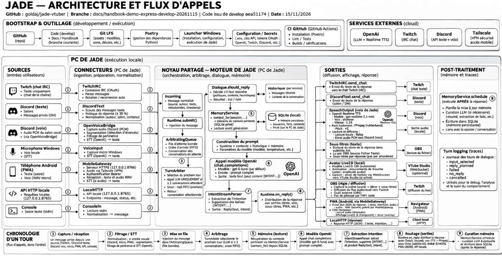
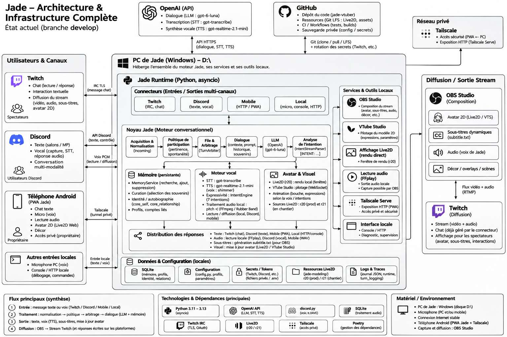

# Schémas de référence de l'architecture de Jade

Ces deux schémas ont été fournis par le propriétaire le **15 novembre 2026** et sont conservés dans cette branche `develop` comme **références visuelles pour les agents IA et les contributeurs**. Leur perspective est complémentaire : le premier détaille la chronologie des appels ; le second localise les composants par machine et service.

## 1. Architecture et flux d'appels

Fichier : [jade-architecture-flux-appels-2026-11-15.png](jade-architecture-flux-appels-2026-11-15.png)

Cette figure illustre le trajet habituel : entrée sur un support, politique de sélection et transcription STT si nécessaire, normalisation en `Incoming`, file de `Runtime`, arbitrage des demandes concurrentes, éventuelle lecture mémoire, `Dialogue`/OpenAI, analyse de l'intention, `Reply`, distribution texte/audio/visuel et éventuelle curation.

## 2. Infrastructure et emplacement des composants

Fichier : [jade-infrastructure-complete-2026-11-15.png](jade-infrastructure-complete-2026-11-15.png)

Cette figure situe les responsabilités du **PC de Jade**, de la PWA Android, des services externes, du noyau Python, des connecteurs, du rendu Live2D et des données locales.

## Règle d'interprétation obligatoire

**Ces PNG sont des vues de référence datées, pas la source de vérité du produit.** Ils ont été élaborés à partir du code de `develop` au 15 novembre 2026, notamment à partir du moteur du commit `aea51174`. Ils peuvent simplifier certaines connexions ou devenir obsolètes après des modifications. Lorsqu'une illustration et le runtime divergent, **le code et les réglages de la branche courante prévalent**.

En particulier :

- **Arbitrage** : `TurnArbiter` ne sollicite le modèle que s'il existe plusieurs conversations en attente et si aucun mécanisme de repli/équité ne suffit ; ce n'est pas un appel systématique sur chaque message.
- **Voix/STT** : les chemins audio font une transcription avant la normalisation des messages de dialogue ; tous les messages ne passent pas par STT ni par TTS.
- **Mémoire** : l'activation et la curation sont conditionnelles ; une commande mémoire peut répondre sans appel LLM de dialogue. La curation est une tâche ultérieure, pas une étape bloquante de chaque tour.
- **Twitch/OBS** : le connecteur Twitch du dépôt lit et répond au **chat IRC**. Les éléments de vidéo du stream passent par une composition OBS externe, non par un encodeur RTMP interne à Jade. Le fichier de sous-titres texte n'est pas aligné mot à mot.
- **Rendu** : l'avatar Live2D autonome et VTube Studio constituent deux voies différentes ; VTube Studio reste optionnel. La PWA possède son rendu Web local au navigateur.
- **Confidentialité** : les réponses privées micro/HTTP/mobile ne doivent pas être réémises automatiquement vers Discord, Twitch ou OBS. La configuration privée du PC peut surcharger les modèles, les voix et les réglages affichés dans les images.

### Lecture avant toute évolution

Consulter [AGENTS.md](../../AGENTS.md), le [guide technique](../handbook/TECHNICAL.md), le [guide de passation des agents](../handbook/AI_HANDOFF.md), puis vérifier impérativement `main.py` et les modules exécutés (`src/jade_runtime/`). Si l'architecture change, **réviser les images et leurs légendes**, et maintenir les documents synchronisés dans **la branche concernée**, sans recopier la description de `develop` sur `main`.

Les deux PNG sont ajoutés tels que fournis, sans retouche. Aucun secret ni donnée privée du runtime ne doit être placé dans ce dossier.

## Extension des flux (15 novembre 2026)

Les figures historiques ne représentent pas exhaustivement cette nouvelle liaison et ne doivent pas être interprétées comme la preuve d'une animation 2D prête. **Lien complémentaire réel :** `Reply.intent` (après filtre `intent_engine`) → `main.py:on_reply` → `Avatar.set_intent` → processus Live2D r20 Windows ; en parallèle `Reply.intent` → `MobileGateway` → `mobile_web/app.js` → `JadeAvatar.setIntent` → expressions r20 et texte PWA. Les deux renderers lisent le même catalogue versionné via `intent_visuals.py` / `intent-visuals.json`, piloté par `JADE_AVATAR_INTENT_ENABLED`. La voix TTS continue séparément, et aucun motion asset « 2 par intention » n'est encore connecté. Les deux schémas devront être **redessinés** par Codex une fois les animations finales r21 et leurs transitions réellement disponibles ; ne pas altérer leurs pixels sans livrer une figure vérifiée. Voir [passation dédiée](../gpt6-jade/LIVE2D-INTENT-ANIMATION-HANDOFF-20261115.md).
