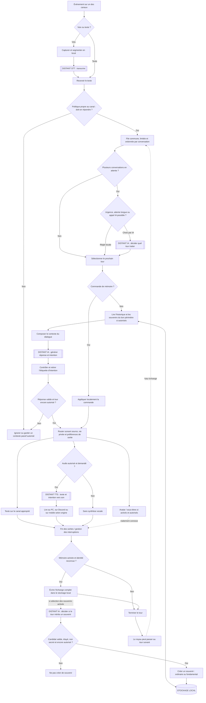
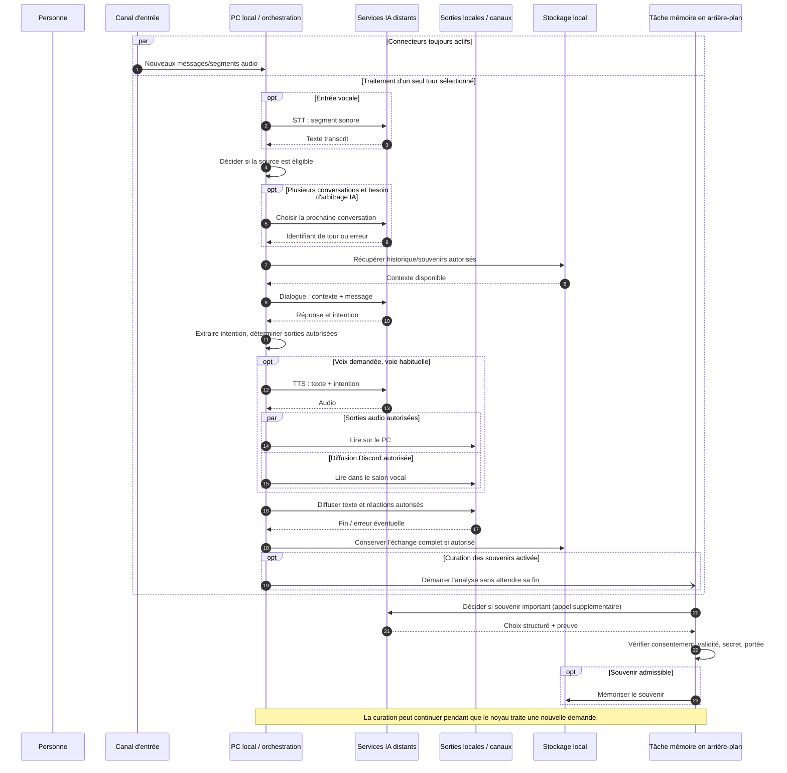

# JADE · Contrat fonctionnel des parcours et décisions

**Complément du 26/11 :** [contrat Live mobile](../LIVE_MOBILE.md), implémenté dans `90ec0c7` et intégré sur `develop` le 26/11. Le dialogue oral natif ne traverse pas STT → dialogue → TTS à chaque phrase. Les délégations métier réutilisent le worker, les droits et la mémoire ; le contexte classique est révisé après persistance Live. Les règles de sérialité de l'instantané ci-dessous restent celles de son SHA, pas une promesse de sérialité absolue des paroles avec Live.

**Version étudiée :** `goldaj/jade-vtuber`, branche `develop`, commit `a841628b37d9d7449c8aeb5c6ca45bc679746655` (15 novembre 2026). Analyse du 16 novembre 2026.

Ce document et les cinq SVG forment un **atlas**, pas une assertion selon laquelle chaque matériel, canal et option est réellement opérationnel sur le PC. Aucun réglage privé ou test end-to-end en conditions réelles n'a été inspecté. Les schémas sont volontairement **fonctionnels**, sans noms de méthodes ni de classes.

## Légende des événements

- **[LOCAL]** : décision, captation, assemblage de contexte, stockage ou lecture effectués sur le PC de Jade (ou sur son navigateur mobile pour l'avatar Android).
- **[DISTANT IA]** : aller-retour au modèle de dialogue, éventuellement pour **l'arbitrage** et la **curation des souvenirs**, en plus de la génération de réponse.
- **[DISTANT STT]** : envoi d'un segment audio pour transcription, et réception du texte.
- **[DISTANT TTS]** : envoi du texte / intention pour génération vocale, et réception du son ou d'un flux sonore.
- **[PLATEFORME]** : arrivée ou émission de messages/audio sur Discord et Twitch ; **[PRIVÉ]** : HTTP local et accès PWA via réseau privé.
- **[DÉCISION]** : condition qui peut arrêter ou bifurquer un parcours ; une décision locale n'est pas obligatoirement une décision IA.
- **[PARALLÈLE]** : plusieurs tâches actives sur un même intervalle ; **[SÉRIALISÉ]** : un tour de dialogue principal à la fois.

## 1. Boucle générale, avec décisions et liaisons

**Note :** la voie vocale anticipée est une alternative conditionnelle décrite plus bas. Dans le mode courant du lancement tous canaux, la génération du texte précède le TTS. La création éventuelle d'un souvenir est **asynchrone** et peut chevaucher le tour suivant.

## 2. Matrice de décisions par support

| Canal | Conditions locales avant le dialogue | Décision de participation | Particularité des retours |
|---|---|---|---|
| **Twitch chat** | Connexion, message valide, autre auteur que Jade ; ignorer les nouveaux messages pendant qu'un tour Twitch est encore en cours | Un seul auteur actif observé en 10 minutes : répondre. En groupe : mention/interpellation ou échantillonnage à 30 % | Texte sur Twitch si envoi autorisé ; audio local/Discord possible si configuré et non privé |
| **Discord écrit** | Ignorer ses propres messages, mémoriser une courte fenêtre de contexte et les humains actifs | MP/mention/réponse à Jade/commande : oui. Seul humain actif : oui. Groupe : suivi et intervention spontanée échantillonnés, cooldown pour spontanée | Texte vers le même canal ; MP exclu du vocal public ; écrit du chat natif vocal peut partager un historique volatil avec la voix de la même personne |
| **Discord vocal** | Capturer PCM sauf Jade, segmenter, vérifier la session ; transcrire à distance ; ignorer bruit ou fragment | Arrêt/reprise traités localement ; seul humain : répondre ; interpellation Jade : répondre ; groupe non interpellé : 30 % | Parole pendant lecture : seulement détecter un éventuel arrêt ; annuler si déplacement/rupture de session |
| **Micro du PC** | Capturer et filtrer silence/écho ; STT distant ; reconnaître l'entrée comme propriétaire | Message direct, sauf erreurs/annulation | Attendre la fin du tour, puis reprendre les captations ; ne pas diffuser cette entrée privée sur le Discord public |
| **Android privé** | Identité réseau privé + jeton, capacité et durée ; texte ou STT si audio | Message direct | Si voix souhaitée, TTS **après** dialogue ; texte + intention + audio renvoyés au navigateur en une réponse ; avatar côté appareil |
| **HTTP local** | Jeton et format textuel, délai de réponse | Message direct | Texte HTTP ; éventuelle lecture sur le PC si option ; pas d'identité de mémoire persistante associée |
| **Console** | Texte local, mode simulation ou service réel | Message direct | Réponse dans la console ; démonstration sans IA distante possible |

### Sous-décisions cruciales

1. **Twitch** distingue un unique auteur **ayant parlé** d'une audience de spectateurs. Un spectateur silencieux n'est pas détecté comme participant actif par le chat.
2. **Discord écrit** ne tire pas à 30 % sur toute la conversation : les messages expressément destinés à Jade ou les MP passent les filtres de participation. En groupe, les suivis contextuels non explicitement adressés restent échantillonnés.
3. **Discord vocal** détecte la parole humaine, mais le chemin actif ne filtre pas les bots autres que Jade avant le traitement. Une commande d'arrêt/reprise est une décision locale, non un appel au modèle de dialogue.
4. **Discord écrit et vocal** peuvent partager un historique *volatile* lorsque l'auteur et le chat natif du salon vocal correspondent à une même session. Un message passif peut enrichir cet historique sans dialogue IA.
5. **Android** n'est pas une source Discord : l'audio revient au navigateur et l'intention est transmise séparément. Le service vocal du PC n'est pas nécessairement utilisé pour sa lecture.

## 3. Chronologie d'un tour vocal et du parallélisme effectif

**Voie progressive distincte** : uniquement quand la source est Discord vocal, que la synthèse accepte les flux, que l'option est activée et que **la sortie PC est désactivée**. Le modèle de dialogue peut alors émettre des fragments, le PC en fait des phrases et le service vocal prépare une phrase tandis que le modèle produit les suivantes. La file de phrases est bornée. Une interruption impose d'arrêter la synthèse, la lecture et la session correspondante. Avec le lancement **tous canaux** décrit dans le code, la sortie PC est exigée, donc cette voie n'est normalement pas sélectionnée.

## 4. Les appels distants possibles pour un seul message

| Numéro fonctionnel | Appel hors du PC | Quand ? | Ce qui revient | En série ou parallèle ? |
|---|---|---|---|---|
| A | **Transcription vocale** | Seulement si la source apporte de la voix | Texte | Avant la sélection après transcription et avant le dialogue |
| B | **Arbitrage de conversation par IA** | Seulement si plusieurs tours en attente, sans règle locale prioritaire et modèle accessible | Choix d'un tour | Avant le tour retenu ; peut ralentir le passage de la file |
| C | **Génération du dialogue par IA** | Tour sélectionné, non écarté et non traité comme commande purement locale | Réponse + intention | Étape centrale ; éventuellement flux de fragments |
| D | **Synthèse vocale** | Une sortie vocale est demandée et autorisée | Son ou flux sonore | Habituellement après C ; peut se chevaucher avec C en voie progressive autorisée |
| E | **Choix des souvenirs par IA** | Mémoire et curation activées, identité admissible, réponse non annulée | Aucun/ordinaire/fondamental, résumé, preuve | Après réponse, en tâche autonome ; peut se chevaucher avec le tour suivant |

Il y a donc **jusqu'à cinq catégories d'appels distants par interaction** dans ce périmètre, mais **certaines sont évitées**, et la voie progressive peut effectuer **plusieurs synthèses vocales successives par phrases**. Ce tableau ne compte pas la connectivité réseau Discord/Twitch ni le transport privé Tailscale, qui ne sont pas des appels d'inférence.

## 5. Conditions de fin, échec et état réel

- **Avant la file :** entrée invalide, surcharge, silence, échantillonnage négatif, doublon ou absence d'autorisation → abandon ou contexte passif autorisé ; aucun dialogue facturé pour ces tours non retenus.
- **Pendant l'arbitrage :** modèle absent, réponse non valide ou délai dépassé → ordre d'arrivée ; urgence et attente ancienne peuvent être traitées directement par règles.
- **Pendant le dialogue :** erreur, délai, résultat vide, réponse interrompue → ne pas lancer les sorties de ce tour ; l'historique peut différer selon le mode.
- **Pendant le vocal :** session Discord déplacée, arrêt vocal, audio interrompu, diffusion invalidée → interrompre l'ancienne sortie et nettoyer le texte OBS ; le statut de lecture n'est pas identique au statut « réponse générée ».
- **Android :** si le TTS échoue après une réponse textuelle, le texte reste disponible et le navigateur reçoit l'indication d'audio indisponible.
- **Après sortie :** l'historique durable exige mémoire et profil éligibles ; la curation échouée ou rejetée ne doit pas inventer de souvenir.
- **Tâches indépendantes :** connexions et reconnexions, validations de jeton Twitch (si activées), suivi des sorties, vie de l'avatar/OBS, gestion d'arrêt, contrôles de lancement et CI. Les tâches GitHub/installation ne sont pas des appels d'inférence à chaque prise de parole.
- **Rendu :** les variantes d'expression actuelles ne sont pas équivalentes aux 14 animations artistiques finales prévues ; l'animation complète reste à intégrer/recetter.
- **Vérification :** seules les lectures des sources GitHub ont été faites ici. Le schéma ne certifie ni le contenu du fichier de configuration privé, ni les connexions réelles, ni les durées/couts réels du PC.

## 6. Point de vigilance de la cartographie

La fonction de journalisation des sorties consigne des **destinations prévues**. Certaines opérations de sortie facultatives sont protégées par des mécanismes qui tolèrent l'échec. Il serait donc incorrect d'affirmer que tout échange marqué « réponse » a été délivré matériellement à chaque destination. L'export d'une métrique de livraison de bout en bout (texte, audio, animation, mémoire) reste un chantier de mesure/recette, et non un acquis du schéma.
