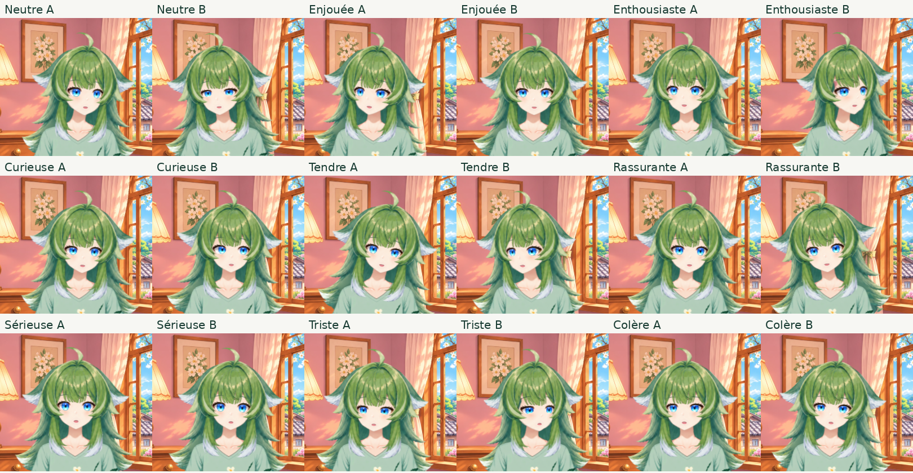
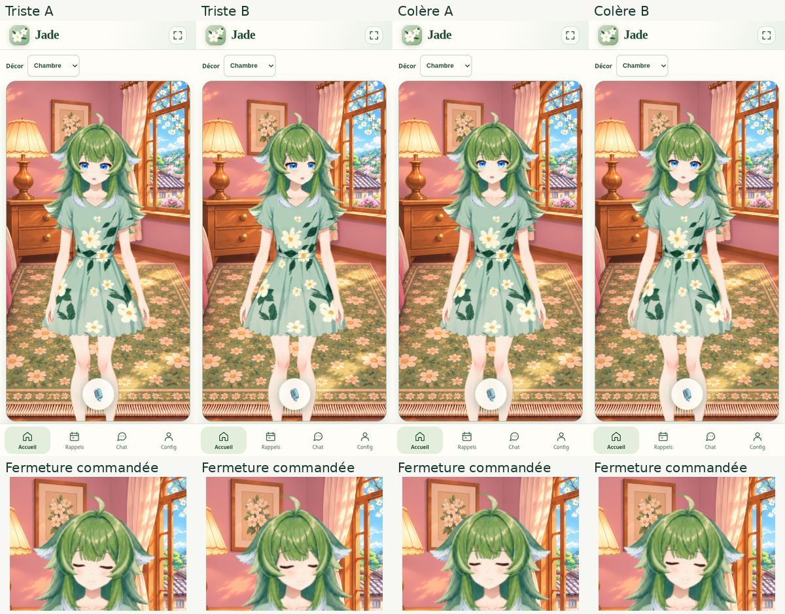
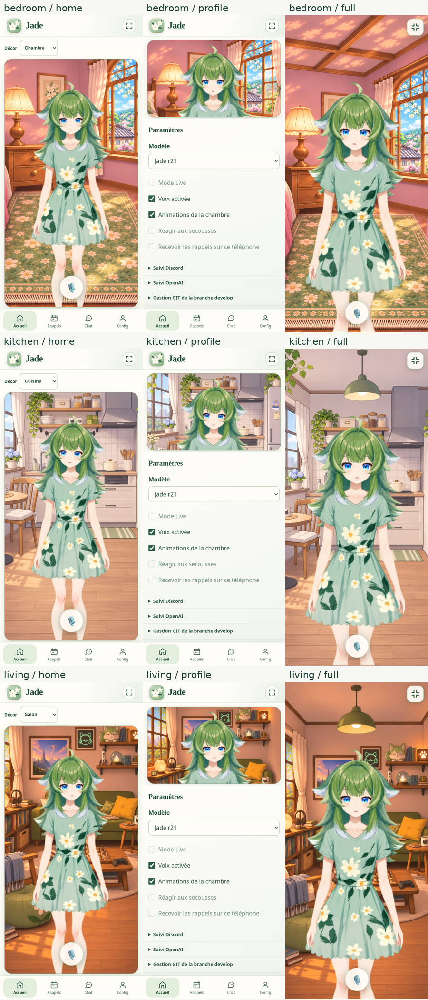

# Recette locale des intentions r21 — 27 novembre 2026

Preuves de la [mission Triste/Colère et non-régression](../../handoffs/2026-11-27-chatgpt-intentions-r21-implementation.md). Modèle **r21 v49.1** exclusivement. Ces observations ne constituent pas une écoute fournisseur ou une recette physique sur Redmi.

## Résultats

- [Core Cubism réel](core-motion-results.json) : **3 587 poses, 18 motions, aucun paramètre hors bornes, géométrie finie, retour au repos**. Empreintes du Core, du MOC, des manifestes et clips. Les quatorze motions mobiles antérieures sont identiques octet pour octet à celles de `d7655cd4` ; cette comparaison Git est une preuve distincte du script portable.
- [WebGL réel](webgl-results.json) : **PASS, 18 variantes, 9 vues**, Chromium 158, fenêtre mobile 393 × 873. Un seul canvas r21, groupe/index du geste vérifiés, bouche animée par Web Audio synthétique, fermeture complète des yeux commandée avant la pose applicative, puis retour au neutre. Aucune erreur de page, requête HTTP échouée, requête externe ou requête r20.
- **Suite du dépôt après retrait des tests r20 : 1 019 tests, 12 skips, aucun échec**. Suite isolée depuis l'export privé : **1 019 tests, 22 skips, aucun échec** ; les skips supplémentaires correspondent aux ressources et capacités volontairement exclues de cet export, dont les cinq contrôles d'atelier. **26 commandes JavaScript distinctes de la CI** réussies, couvrant r21 et les fonctions mobiles communes. Préflight : **290 sources Python/TOML**, sans erreur. Contrat documentaire et intégrité du backlog réussis.
- **Contre-revue des captures :** textures et identité continues dans les neuf intentions ; quatre nouvelles poses et deux chorégraphies par nouvelle intention ; aucun iris persistant lors des fermetures commandées. Modèle présent dans les trois décors et les trois cadrages. Le rig existant limite l'amplitude et la lisibilité des expressions ; les visages manga redessinés restent ART-015.

Les neuf vues correspondent à **Chambre / Cuisine / Salon × Accueil / mini-scène de Config / plein écran**. Le banc charge le HTML, les styles, le chargeur et le moteur d'avatar réels. Il simule les événements de réponse et le changement de vue ; il ne constitue pas une navigation authentifiée complète. Les tests du client couvrent séparément réception des intentions, lecture, interruptions et arrêt.

Les suites de corps hybride, tête isolée, assets et comportement r20 ainsi que ses trois scripts de recette VTS sont retirés sur décision du propriétaire. Les bancs actuels n'utilisent plus ce modèle comme référence de cadrage. Ils vérifient directement r21, dont la présence, le chargement, les interruptions, les poses, les gestes et la visibilité. Les tests de **mode vocal classique** restent nécessaires et ne concernent pas l'ancien modèle graphique.

## Captures

Les planches sont des assemblages et recadrages de captures du navigateur, sans redessin du modèle. L'instant illustré ne remplace pas l'ensemble de la motion.

### Dix-huit variantes



### Quatre nouvelles variantes et fermeture commandée des yeux



### Neuf vues



## Reproduction

Dans un checkout complet, hydrater les seules ressources LFS référencées par `Jade_r21_mobile.model3.json`. Fournir le Web SDK autorisé d'une installation Jade, un exécutable Chromium et Playwright. Aucune clé fournisseur, aucun compte, microphone ou serveur Jade n'est requis. Le serveur de recette écoute uniquement sur loopback ; toute requête extérieure est bloquée et rend le contrôle rouge.

```bash
r21_bundle=jade-modeling/assets/live2d/r21_professional_art/livraison/Jade_r21_v45_1
python jade-modeling/tools/export_r21_intent_motions.py "$r21_bundle/Edition/mobile-intentions/Jade_sad.psd2live-motions.json" "$r21_bundle/Jade_r21_v45/mobile" --check
python jade-modeling/tools/export_r21_intent_motions.py "$r21_bundle/Edition/mobile-intentions/Jade_angry.psd2live-motions.json" "$r21_bundle/Jade_r21_v45/mobile" --check
python -m unittest discover -s tests -p test_r21_new_intent_motions.py -v
node tests/mobile_r21_intents_test.js
node tests/mobile_live_app_test.js
node jade-modeling/tools/check_r21_intent_motions.cjs /path/to/live2dcubismcore.min.js /path/to/Jade_r21_mobile.moc3
python tools/jade_r21_visual_qa.py --sdk-dir /path/to/vendor --chromium /path/to/chromium --output /path/to/qa-results
```

Le script Core prend facultativement un troisième argument `MODEL3_JSON`. Il vérifie le MOC fourni contre l'empreinte du fichier ou pointeur LFS référencé par le manifeste ; sa sortie standard est un rapport JSON. La vérification comparative des quatorze anciens clips est indépendante et n'introduit pas de dépendance Git dans ce script.

Le banc WebGL écrit ses captures et `results.json`, marqué `PASS` seulement après tous les contrôles. Un rapport `INCOMPLETE` ne vaut jamais réussite. `--new-only` permet un diagnostic des quatre nouvelles variantes ; la preuve de cette livraison utilise la campagne complète, sans cette option.

La suite Python de l'export privé exclut volontairement l'atelier et ses modèles. Les cinq tests d'assets n'y sont ignorés que si le marqueur officiel d'export est présent **et** si `jade-modeling` est entièrement absent. Un fichier manquant dans un vrai checkout ou un atelier incomplet reste une erreur ; la CI du dépôt complet exécute les cinq contrôles.

## Observations encore nécessaires

Écoute des neuf intentions sur les voies vocales réellement configurées, observation des dix-huit variantes sur le Redmi et acceptation du jeu artistique. La fermeture synthétique vérifie la composition géométrique des paupières et des poses ; elle ne prouve pas la fréquence du clignement naturel pendant une conversation. Aucune réfection de dessin, aucun export natif Cubism d'ART-015 ni essai Windows/VTube Studio n'est présenté comme effectué.
